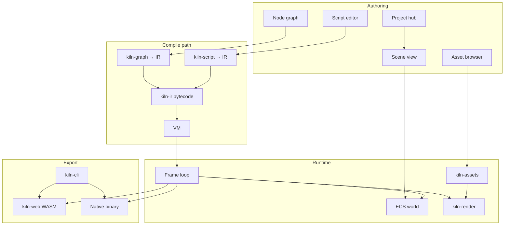

# Kiln Architecture

## Goals

Kiln is a **product**: Editor + Runtime + CLI sharing one engine core. Creators install a small native app, author scenes/graphs/scripts, and export to Web (WASM), desktop, and later mobile—from one project tree.

Constraints that shape every design choice: **tiny binaries**, **old-hardware tiers**, **git-friendly projects**, **one IR/VM for visual and text gameplay**.

## Workspace crates

| Crate | Responsibility | Depends on (intended) |
| --- | --- | --- |
| `kiln-core` | `glam` math, clocks, IDs, ECS world glue, shared errors | — |
| `kiln-render` | wgpu device/swapchain, 2D batching → 3D, post, render tiers | core |
| `kiln-assets` | Importers, content-hash cache, KTX2/meshopt/audio, pack | core |
| `kiln-ir` | IR AST, bytecode, VM, host call table | core |
| `kiln-script` | Lexer/parser/typecheck/codegen → IR (`LanguageFrontend` trait) | ir, core |
| `kiln-graph` | Graph model, live preview bindings, compile → IR | ir, core |
| `kiln-runtime` | Frame loop, scene, input, optional audio/physics features | core, render, assets, ir |
| `kiln-editor` | winit + egui shell, panels, PIE, undo | runtime, graph, script, assets |
| `kiln-cli` | `build` / `export` / `pack` / CI entrypoints | runtime, assets, ir |
| `kiln-web` | wasm-bindgen shell, canvas, WebGPU/WebGL2 | runtime |
| `kiln-plugin-api` | Stable ABI + host imports for sandboxed WASM plugins | core (thin) |
| `samples/` | Vertical-slice games and tutorial project | (consumers) |

**Rule:** crates talk only through documented public APIs. No `pub use` of another crate's internals. Optional Cargo features: `3d`, `physics`, `audio`, `networking` (default features stay minimal for web size).

## Data flow



## IR and dual frontends

Both Blueprints-style graphs and text scripts compile to the **same IR** and execute on the **same VM**.

### IR sketch

- **Modules** of functions + static data; functions are flat instruction streams.
- **Ops (illustrative):** `Nop`, `LoadLocal`/`StoreLocal`, `LoadConst`, arithmetic/compare, `Jump`/`JumpIf`, `Call`/`Ret`, `CallHost` (scene, input, math, assets), `MakeClosure` (later).
- **Types:** scalars, vectors (via host/`glam`), entity/component handles as opaque IDs, strings in a string table.
- **Diagnostics:** spans map back to graph node IDs or script source ranges for editor squiggles.

### Frontend trait (swappable language)

```text
trait LanguageFrontend {
    fn parse(&self, src: &str) -> Result<Ast, Diags>;
    fn check(&self, ast: &Ast, host: &HostApi) -> Result<(), Diags>;
    fn emit(&self, ast: &Ast) -> Result<IrModule, Diags>;
}
```

- **Default proposal (open ADR):** ship **Rhai** (`1.26.1`) behind this trait for M5 speed-to-editor, with a path to a purpose-built **KilnScript** if Rhai size/semantics fight budgets.
- Graphs can show **generated script** (pretty-print IR or frontend AST).
- Scripts can register **custom nodes** (metadata + host call) consumed by `kiln-graph`.

## Editor architecture

- **Default: pure-Rust native** — `winit` + `wgpu` + `egui` (via `egui-wgpu`), **not** Electron. Tauri only with a justifying ADR.
- **Shell:** docking panels (`egui_dock` or equivalent), project hub, scene view (engine framebuffer as egui texture), inspector, asset browser, graph editor, script editor, console/profiler.
- **Play-in-editor:** shared `kiln-runtime` instance; hot reload swaps IR modules / assets by content hash without full process restart when possible.
- **Undo/redo:** command pattern over project document mutations (not raw ECS snapshots).

Pinned ecosystem versions (verified crates.io / docs, 2026-10-18):

| Dep | Version | Notes |
| --- | --- | --- |
| `wgpu` | **30.0.1** | WebGPU + WebGL2/GL fallback; MSRV 1.87 |
| `winit` | **0.30.13** | Stable; 0.31 still beta |
| `egui` / `eframe` | **0.37.0** latest; **pin 0.36.x for M6–M8** if using snarl/dock |
| `egui-snarl` | **0.12.0** | Requires **egui ^0.36**; MSRV 1.92 |
| `egui_dock` | **0.21.1** | Requires **egui ^0.36** |
| `wasm-bindgen` | **0.2.129** | |
| `web-sys` | **0.3.106** | |
| `glam` | **0.34.1** | |
| `zstd` | **0.14.3** | Archive compression |
| `brotli` | **9.0.0** | Web payload measure |
| `rapier2d` | **0.36.1** | Feature-gated physics (M11) |
| `rhai` | **1.26.1** | Candidate script frontend |
| `meshopt` | **0.7.0** | Mesh compression |
| `cargo-dist` | **0.32.0** on crates.io; **0.33.0** via GitHub installer | Packaging |
| `trunk` | **0.21.14** | Web dev serve candidate |
| `wasm-pack` | **0.15.0** | Alt web tooling |

**Node-graph UI proposal:** prefer `egui-snarl` for M8 unless custom UX wins; accept **egui 0.36 pin** until snarl/dock catch 0.37 (ADR-0004).

## Render tiers

Runtime GPU detection selects **Low / Medium / High**. Every effect declares cost and a degrade path. Editor toggle **Preview as low-end** forces Low.

| Tier | Intent |
| --- | --- |
| Low | No post; baked light; no soft shadows; 16.6 ms on 2015 iGPU reference |
| Medium | Cheap bloom, LUT grading, fog, outline, simple soft shadows |
| High | WebGPU compute extras when available |

Start **2D / 2.5D** lit sprites + tilemaps; add **3D** after the 2D vertical slice (M14+).

## Asset pipeline

1. Source files → importers → **content-hash** cache entries.
2. Textures → **KTX2 / Basis Universal**; meshes → **meshopt**; audio → **OGG/Opus**.
3. Ship as one **packed archive** (zstd native; brotli measured for web).
4. Incremental: only reimport when hash or importer version changes.
5. CLI (`kiln-cli`) and editor share the same pipeline crate.

## Project file format

Human-readable, **git-friendly**, mergeable text (proposal: **RON** or **TOML** for manifests; YAML discouraged for merge noise).

```text
my_game/
  kiln.toml              # project id, features, export defaults
  scenes/*.ron           # entity/prefab trees (stable IDs)
  graphs/*.kgraph        # node graphs (RON/JSON + layout)
  scripts/*.ks / *.rhai  # text gameplay
  assets/                # sources; .kiln-cache/ gitignored
  packs/                 # optional checked-in small packs for samples
```

- Prefer **one entity / one resource per file** for conflict reduction where practical.
- Stable UUIDs for entities and asset refs; never rewrite unrelated IDs on save.

## Plugin points (M14+)

- Rust plugins compiled to **WASM**, loaded via `kiln-plugin-api`, sandboxed.
- Extension kinds: custom graph nodes, importers, editor panels, host calls (capability-gated).
- No native `cdylib` in default product path (size + safety).

## ECS choice (open)

Evaluate standalone **`bevy_ecs` 0.20.0** vs **`hecs` 0.11.2** vs tiny custom. Decision criterion: **binary size + compile time** for `kiln-web` and editor. See ADR-0002.
