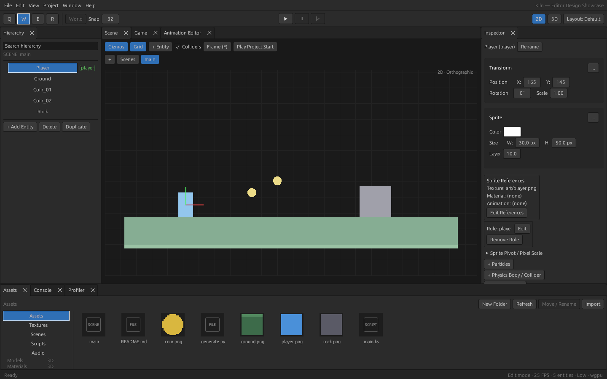
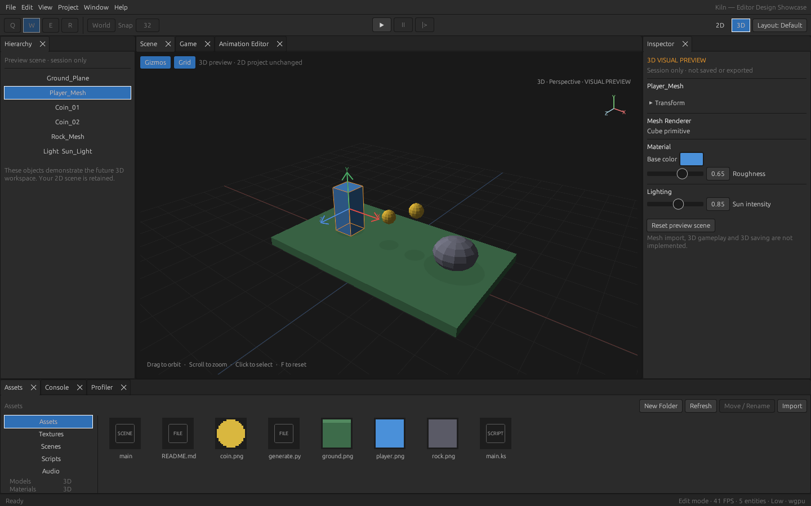

# Native editor design

The editor applies the supplied **Kiln Editor — UI design.html** to its native
Rust/egui workspace. The attachment was used as a visual reference; its bundled
JavaScript is not shipped or executed by the editor. No web wrapper or new
runtime dependency is required.

## Try it

Run `cargo run -p kiln-editor --bin kiln-editor` and open
`samples/editor_design/kiln.toml` through **File → Open Project**. Select Player
in the hierarchy. This is an ordinary saved 2D project with original small PNGs,
not an illustration painted over the viewport. Play runs the actual script;
arrows/WASD move the blue player. The showcase does not implement a full game.



The default layout includes hierarchy and inspector sidebars, Scene/Game/
Animation tabs, and an Assets/Console/Profiler shelf. Panels retain docking,
resizing and existing editor commands. **Window → Reset Layout** or **Layout:
Default** restores this arrangement. The global toolbar provides Q/W/E/R tools,
world-space transforms, grid snapping, Play/Stop, pause and frame stepping.
Local transforms remain in the inspector. The viewport provides grid/gizmo/
collider visibility, framing and real saved scene tabs.

The asset shelf contains actual bounded image thumbnails, category/search
filters and scene cards. Double-click a scene card to open it. Drag image
cards into the 2D viewport to create sprites; import, folder creation,
refresh, rename and texture settings retain their existing command paths.
Thumbnails retain at most 128 64×64 textures (~2 MiB); additional files use
ordinary cards. Changing projects releases the cache.

## 3D visual preview

Click **3D** in the top-right toolbar. This opens the Scene tab and displays a
separate perspective demonstration with a platform, lit cube, faceted meshes,
contact silhouettes, grid, selection bounds and an axis compass.



- Drag the viewport to orbit and scroll to zoom. F over the viewport resets
  the camera. Click a mesh or a preview hierarchy row to select it.
- Expand Transform in the inspector to change temporary position, scale and
  Y rotation. Base color, roughness and sun intensity update the preview.
- Grid/Gizmos control preview overlays. Reset preview scene restores the demo.
- **2D** restores the actual authored scene and selection. Game always shows
  the real 2D project. Play starts the actual 2D scene; 3D mode is disabled
  while a game runs. Q/W/E/R and snapping remain 2D authoring tools.

Preview data is session-only. Saving a project does not serialize these objects,
materials or lighting. Mesh import, 3D gameplay/physics, 3D gizmo manipulation,
3D saving and 3D exports remain unimplemented. The disabled 3D sections in the
2D inspector and asset rail communicate that boundary. This checkpoint does not
resume the full 3D engine milestone or finish Task 7.

## Verification

Run the usual `just check` and `just test` gates. To repeat native acceptance:

```sh
cargo build -p kiln-editor --bin kiln-editor
KILN_EDITOR_EVIDENCE_DIR=target/editor-design-evidence python3 tests/native/editor_smoke.py
```

The smoke test requires Xvfb, xdotool and ImageMagick. It uses an isolated display,
XDG profile and disposable project copy; `KILN_EDITOR_DISPLAY` can choose another
unused display. It edits an actual inspector field, saves, undoes/redoes, reopens
in a fresh editor, exercises 3D orbit/lighting and verifies byte-for-byte project
isolation. It then checks actual rendered player movement, pause, a single frame
step and Stop restoring the authored world. Logs/screenshots/result.json are
retained under the evidence directory. CI runs it alongside native saved-UI
acceptance and uploads both sets of evidence.

Regression tests also cover hierarchy click/drag, responsive dock geometry,
transport hit testing, quick Play input edges with display scaling, preview
projection/geometry/hit tests and thumbnail resource lifetime at its limit.
The native smoke test caught a pre-existing Context lock re-entry in editor
Play input; display scale is now read before taking the input lock.

Cloud software graphics is useful regression evidence; remote CI execution,
other desktop platforms and hardware acceptance remain separately tracked.
