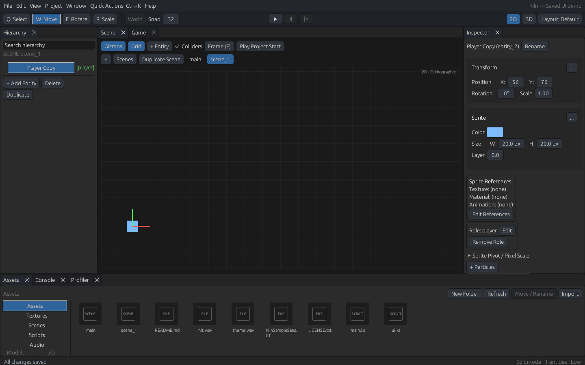
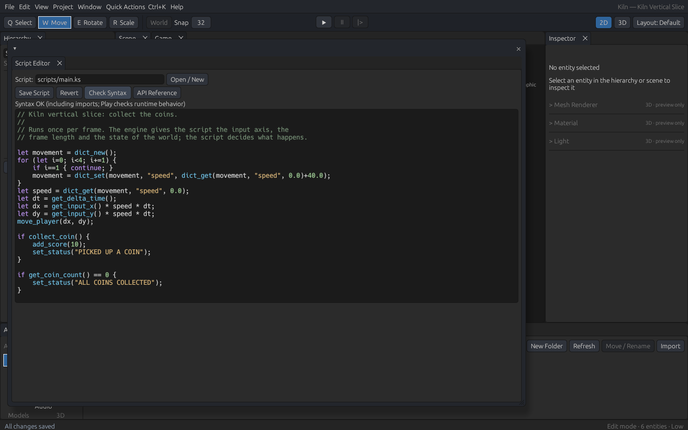

# A02–A04 authoring and scripting batch — 2026-11-14

Branch `fix/a01-ci-baseline`, based on `16b0e7b`; changes and tests are in the
commit containing this record. The owner requested continuing through A04
(ADR-0080/0081). All three milestones remain PARTIAL; no release gate is closed.

## Implemented and exercised

- **A02:** Copy/Paste captures selected subtrees with all supported components,
  detached world poses and remapped parent/joint/prefab-instance IDs. Clipboard
  scope is the current project; paste uses one authoritative undo transaction.
  Invalid dependencies do not change the scene or history. Native egui platform
  output now reaches the OS clipboard. Real hierarchy selection, system Copy/Paste,
  undo/redo, second-scene creation/paste, save and restart preserve properties.
- **A02:** manifest saves compare the disk document with the last successful
  load/save before writing. External edits, deletion or corruption stop the save;
  formatting-only changes are allowed. Save As refuses another existing manifest
  even in the same directory. Source/recovery guards remain active. These are
  pre-write checks, not a filesystem lock or multi-file transaction.
- **A03:** once-per-second size/mtime polling refreshes asset listings, selected
  PNG previews and actual scene textures without rewriting project IDs/references.
  Keep filters, reject preview paths outside the project, and omit recovery/export
  outputs. Real framebuffer pixels change after an external PNG overwrite and
  change back after restoring the original bytes; the manifest remains untouched.
- **A03:** accepted atlas rectangles now drive fit checks, copied pixels and UVs.
  Failed additions leave the existing layout intact. Invalid image data, dimensions,
  names and padding order are reported; `pack_atlas` uses fallible construction.
  Boundary/shelf tests inspect actual pixels and transparent padding.
- **A04:** scoped `for` loops with break/continue/return and deterministic,
  bounded dictionaries reuse the compiler, IR and shared host registry. Dictionaries
  preserve nested values and large integers through real logical saves/restarts
  and preference JSON. See [language contract](../KILNSCRIPT.md).
- **A04:** syntax colors retain unfinished/Unicode buffers; the API Reference
  searches actual registered built-ins. Bytecode stepping now executes, Continue
  resumes past a reported breakpoint, locals update, Step Over/Out follows real
  bytecode call depth, and both full runs and steps obey the configured budget.
- **A04:** the real Script Editor authors movement whose speed is computed by
  counted-loop/dictionary operations. Both native and browser exports are produced
  from a freshly packaged installation, retain its original notices/runtime bytes,
  and reject overwriting valid output. Rendered native/browser movement and key
  release pass. This is a useful feature regression, not the complete A04 enemy/
  projectile/trigger plus equivalent graph/debugger acceptance game.

## Reproduction and evidence

Use the workspace toolchain/environment described in STATE.md. Native tests
require Xvfb, xdotool and ImageMagick; browser tests require Playwright/Chromium.
Generated evidence remains under `target/`; selected screenshots are retained above.

| Check | Command / evidence | Outcome |
| --- | --- | --- |
| Native quality gate | `just check`; `target/a02-a04-check.log` | Passed |
| Workspace Rust tests | `cargo nextest run --workspace --locked`; `target/a02-a04-nextest.log` | Final count recorded in STATE.md |
| Python regressions | `python3 -m unittest discover -s tests/native -p 'test_*.py'` | Final count recorded in STATE.md |
| WASM, default and feature-off | `cargo clippy -p kiln-web --target wasm32-unknown-unknown [--no-default-features] -- -D warnings` | Both passed |
| Browser build/bindings | `cargo build --locked --target wasm32-unknown-unknown -p kiln-web`, matching `wasm-bindgen`, `kiln-cli web-runtime` | Passed |
| Clipboard widgets/restart | `python3 tests/native/entity_clipboard_smoke.py` | Passed |
| External refresh/source authoring | `python3 tests/native/asset_script_workflow_smoke.py [--web-runtime target/debug/web-runtime]` | See final STATE.md / result JSON |
| Native structured export play | `python3 tests/native/structured_export_play.py 'target/a03-a04-workflow/installed-exports/native game'` | Passed; player X 119.5 → 137.5; no movement after release |
| Browser exported loader/play | `CHROMIUM_PATH=/usr/bin/chromium WEB_SMOKE_EXPORT_ROOT='…/installed-exports/browser game' node tests/web/smoke.cjs target/debug/web-runtime` | Passed; 392 player pixels, X 119.5 → 133.5, key release passed |
| Recovery compatibility | `python3 tests/native/script_recovery_smoke.py` | Final rerun recorded in STATE.md |
| Hosted Skybridge failure | Full `task9_editor_games.author` replay with current tools | Passed; project matches checked-in game, including every saved binding |
| Workflows/docs | actionlint 1.7.7, mdBook 0.4.52 | Final outcomes recorded in STATE.md |

Raw records: `target/a02-entity-clipboard/result.json`,
`target/a03-a04-workflow/result.json`, `target/a03-a04-workflow/exports.json`,
`target/a04-structured-native/result.json`, `target/a04-structured-browser.log`,
`target/a01-skybridge-binding-verified/result.json`, `target/a02-script-recovery/result.json`.
CI runs the clipboard, asset/script authoring and browser-play regressions and
uploads their screenshots/logs. General/source-specific acceptance stays active.

Two harness setup failures were retained: installed-notice verification cannot
run against bare development binaries without an installation license tree;
local Playwright also required `CHROMIUM_PATH=/usr/bin/chromium`. A fresh complete
bundle and explicit local Chromium fixed those prerequisites. A separate exported
runtime module needed initialization before the missing-canvas negative check;
the assertion remains active in both smoke modes.

## Remaining work and limits

A02 still needs lock/hide, alignment and the combined full transform/selection/
recovery acceptance. A03 still needs the complete renamed-art/multi-scene prefab/
atlas/export acceptance, nested prefabs/variants and platform import presets.
Polling cannot detect changed content if size and modification time are preserved.
A04 still needs enums, timers/coroutines, contextual completion, search/formatting/
navigation, live source breakpoints/statement stepping/imported frames/watches,
and fully editable/inspectable graph acceptance. The repaired bytecode debugger
is not a debugger attached to the live gameplay VM.

Linux Xvfb/software graphics and Chromium software rendering do not establish
physical GPU/audio/input or Windows GUI acceptance. Latest hosted general CI and
Linux candidate pass on 16b0e7b; reference binding and Windows window-readiness
repairs need fresh matching-source hosted results. See
[A01 hosted snapshot](A01_HOSTED_STATUS.json). Full 3D remains gated on G2D.
